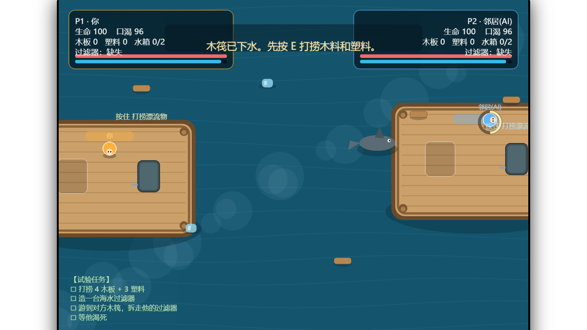
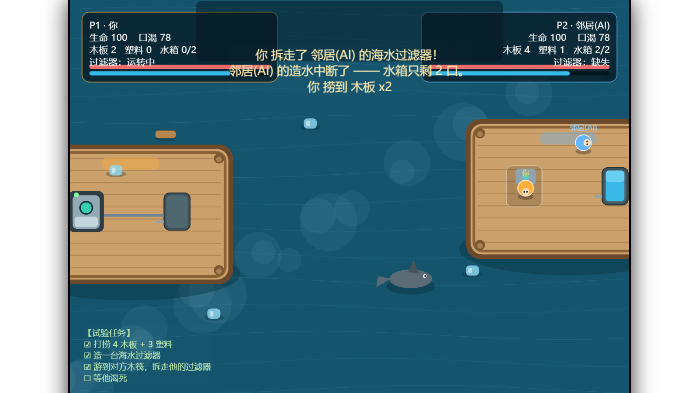
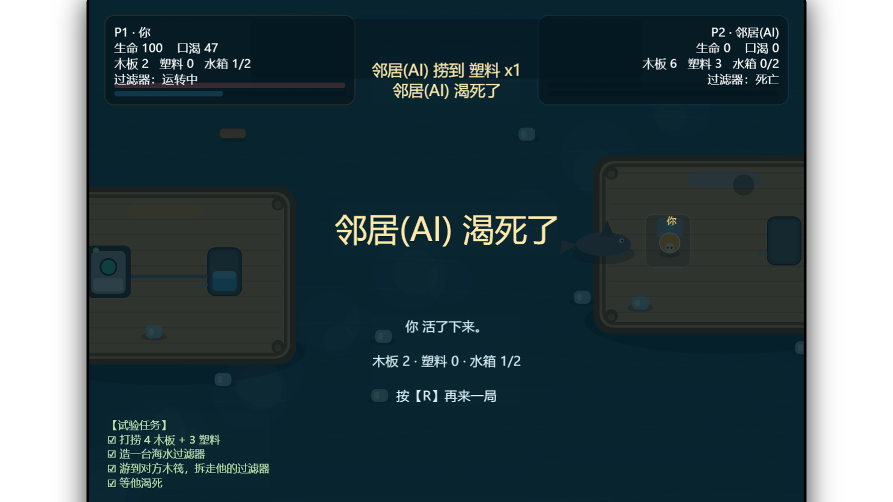

# 咸潮 · 木筏掠夺试验场

> 一个双人木筏生存 Demo。唯一目的：让你亲手试一次 ——
> **把别人木筏上的海水过滤器拆走，看他渴死。**

Cocos Creator **3.8.8** 工程，TypeScript，零美术资源（全部用 `cc.Graphics` 矢量绘制）。

---

## 🎮 在线试玩

**https://xunxun42.github.io/XianchaoRaft/**

打开后按 `1`（单人打 AI）或 `2`（双人同屏）开始。

> 首次打开要拉 10MB 资源，黑屏 10~20 秒是正常的，等它加载完就好。
> 不想等也可以下载 `docs/` 目录或直接跑本地版（见下面"本地运行"）。

---

## 截图

| 开局 | 拆走邻居的过滤器 | 他渴死了 |
|---|---|---|
|  |  |  |

---

## 玩法

### 键位

| 操作 | P1（你） | P2（双人模式时） |
|---|---|---|
| 移动 | `W A S D` | `↑ ↓ ← →` |
| 互动 | `E` | `Enter` 或 `/` |
| 单人 / 双人 | `1` / `2` | |
| 重开 | `R` | |

`E` 是上下文相关的：站在漂流物旁边是打捞，站在空设备位是建造，站在水箱旁边是喝水，站在**对方的过滤器**旁边按住 2.6 秒是**拆走**，站在对方人旁边是推开他。

### 四步流程（左下角有清单会打勾）

1. 按 `E` 打捞漂过来的木板和塑料
2. 攒够 **4 木板 + 3 塑料**，站到自己木筏的空设备位，按住 `E` 造海水过滤器
3. **直接走进海里**（走出木筏边缘就自动下水），游到对面木筏，站到他的过滤器旁边按住 `E` 2.6 秒 —— 拆走
4. 抱着过滤器游回来装上。他的造水中断，水箱喝完就会渴死

海中间有条鲨鱼，专咬水里的人。抱着过滤器游回来的时候最危险。被抢的人也能反击：走到对方身边按 `E` 推开，抱着过滤器的人会被撞掉，过滤器掉海里。

---

## 设计要点

这个 Demo 只验证一条因果链：

```
过滤器 = 造水 → 没水 = 渴 → 渴死
```

比起上僵尸，先说清楚"断水会死"这件事更容易被理解，也更容易调平衡。

数值全部集中在 `assets/scripts/GameRoot.ts` 顶部的 `CFG` 里：

```ts
thirstRate: 2.2,    // 每秒口渴 —— 调到 5 就是 40 秒死
tankMax: 2,         // 水箱能存几口
prodTime: 16,       // 过滤器几秒产一口水
stealTime: 2.6,     // 拆过滤器要按住多久
buildWood: 4, buildPlastic: 3,
sharkDmg: 16,
```

浏览器控制台里还有个后门（方便调式）：

```js
__game.players[1].filter = false   // 直接扒掉邻居的过滤器
__game.players[0].wood = 20        // 给材料
```

---

## 本地运行

### 方式一：Cocos Creator（改代码用）

用 Cocos Creator 3.8.x 打开本目录，按 `Ctrl + P` 预览。

> `library/`、`temp/`、`build/` 没有提交，编辑器首次打开会自动生成。

### 方式二：直接跑网页版

```bash
node tools/serve.mjs docs 8123
# 浏览器打开 http://127.0.0.1:8123/
```

（网页版不能直接双击 `index.html`，浏览器会拦 `file://` 的跨域请求。）

---

## 目录结构

```
assets/
  scenes/Game.scene      唯一场景：Canvas + Camera + App(挂着 GameRoot)
  scripts/GameRoot.ts    全部逻辑 + 全部绘制（约 1300 行）
settings/                项目设置（设计分辨率 1600x900，fitHeight）
docs/                    构建好的网页版（GitHub Pages）
screenshots/
tools/serve.mjs          本地静态服务器
```

---

## 还没做的

- 没有僵尸（先走"断水 → 渴死"的路子）
- 没有自由建造（固定设备位）
- 没有联机（本地双人 + AI 邻居）
- AI 只会：打捞 → 造过滤器 → 喝水 → 你来抢就冲过来推你

---

## License

MIT
